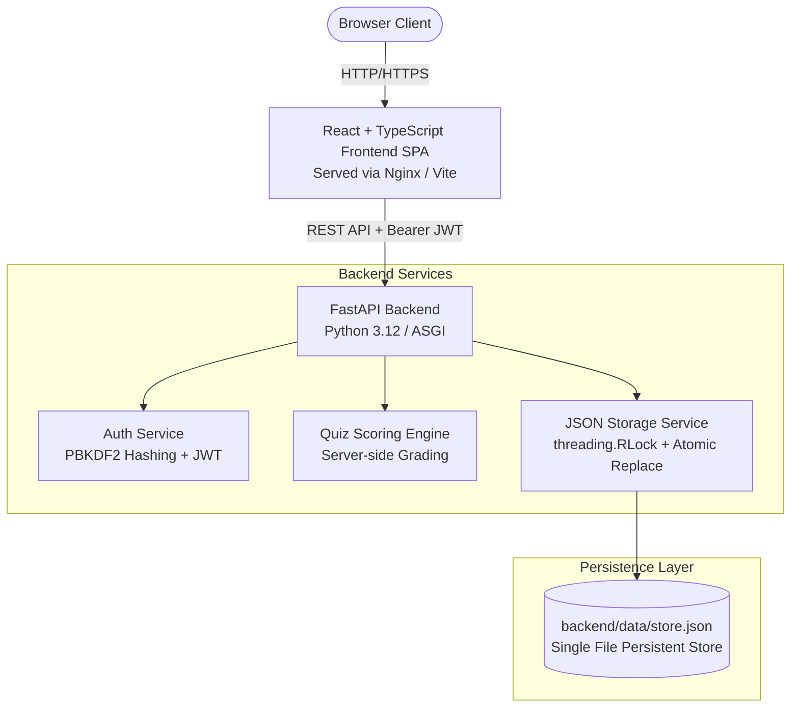

# System Architecture — Online Quiz Application

## 1. Architectural Overview

The **Online Quiz Application** is a decoupled full-stack educational assessment platform designed for clean demonstrations and DevOps deployment practices. It deliberately avoids traditional database management systems (RDBMS / NoSQL) and relies entirely on an in-process, thread-safe JSON persistence engine.

---

## 2. Component Breakdown

### Frontend (Client Tier)
- **Technology:** React 19, TypeScript, Vite, React Router 7.
- **Styling:** Custom responsive CSS adhering to strict design guidelines:
  - Primary Action: `#2563EB`
  - Text: `#0F172A`
  - Canvas Background: `#F8FAFC`
  - Borders: `#E2E8F0`
- **State & Communication:** Centralized API client (`src/api/client.ts`) with request interceptor for automatic `Authorization: Bearer <token>` injection, unified error parsing, and session revocation upon receiving HTTP 401.

### Backend (Application Tier)
- **Technology:** Python 3.12, FastAPI, Pydantic v2, PyJWT.
- **Modular Routing:**
  - `/api/auth`: Registration, login, and user identity profile (`/me`).
  - `/api/quizzes`: Public student assessment catalog, sanitized question retrieval, and answer submission.
  - `/api/attempts`: Attempt historical records and question-by-question review with answer explanations.
  - `/api/admin`: Administrative dashboard statistics, quiz CRUD, and question pool management.
  - `/api/health`: Health probe reporting system and storage availability.

---

## 3. JSON File Persistence Engine

The application replaces external database drivers with a dedicated `StorageService` (`backend/app/storage.py`):

1. **Automatic Initialization & Seeding:**
   - On startup, the service verifies whether `backend/data/store.json` exists.
   - If missing, it creates the parent directory hierarchy and populates seed data (1 Admin, 1 Student, and 3 rich sample quizzes with at least 5 MCQs each).
   - If the file exists and contains valid JSON, existing records are preserved and **never overwritten**.
2. **Safe Write & Atomic Replacement Strategy:**
   - Direct file overwrites risk file corruption if a server terminates mid-write.
   - To guarantee data integrity, writes are performed via a temporary file in the same directory (`tempfile.NamedTemporaryFile`), synced to disk (`os.fsync`), and replaced atomically using `os.replace()`.
3. **Thread Safety:**
   - Multi-threaded request handlers acquire a re-entrant lock (`threading.RLock()`) around reading and writing operations, preventing race conditions.
4. **Data Validation:**
   - Incoming requests and store records are parsed and validated through Pydantic v2 schemas.
   - Malformed or unreadable JSON files trigger a `StorageError` resulting in an HTTP 500/503 status rather than silently erasing data.

---

## 4. Security & Authentication Architecture

- **Password Security:** Passwords are hashed using NIST-compliant **PBKDF2-HMAC-SHA256** with 100,000 iterations and a cryptographically secure 16-byte salt (`os.urandom(16)`). Plain-text passwords are never stored. Constant-time comparison (`hmac.compare_digest`) guards against timing attacks.
- **JWT Authorization:** Tokens are cryptographically signed with HMAC-SHA256 (`HS256`).
- **Role-Based Access Control (RBAC):** Endpoints are protected via FastAPI dependency injection (`Depends(require_role(Role.ADMIN))`). Any attempt by a `STUDENT` to access admin routes immediately returns `HTTP 403 Forbidden`.
- **Cheat Prevention:** Correct answer indices (`correct_index`) and explanations are strictly stripped from student quiz endpoints (`/api/quizzes/{id}`). Scoring is computed exclusively on the backend when an attempt is submitted.

---

## 5. Cloud Run Ephemeral Storage Limitation

> [!WARNING]
> **Demonstration Architecture Limitation:**
> Google Cloud Run runs container instances with an in-memory/ephemeral writable filesystem. 
> - Each Cloud Run instance maintains its **own separate filesystem**.
> - When an instance scales down to zero, terminates, or restarts, any modifications made to `store.json` on that instance are lost.
> - Multiple concurrent Cloud Run instances will **not** share writes to `store.json`.
>
> This architecture is tailored specifically for local development, academic evaluation, and live demonstrations. In a full production environment, Cloud Run should connect to managed storage such as Google Cloud SQL (PostgreSQL), Google Cloud Firestore, or Google Cloud Storage.
