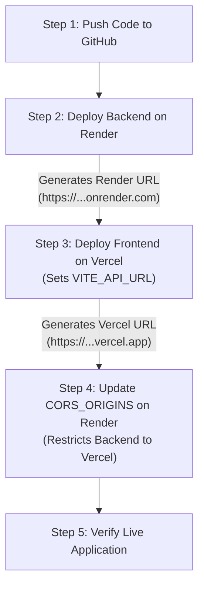

# Free Tier Deployment Guide — Vercel (Frontend) & Render (Backend)

This guide walks you through deploying the **Online Quiz Application** using **100% free hosting services**:
- **Frontend:** Hosted on **[Vercel](https://vercel.com)** (Free Hobby Tier).
- **Backend:** Hosted on **[Render](https://render.com)** (Free Web Service Tier).

---

## 1. How and Where the JSON Data is Stored on Render

### Where is the JSON File Located?
By default, the backend stores data at:
```text
backend/data/store.json
```
On Render, your application runs inside a Linux virtual container. The path resolves to:
`/opt/render/project/src/backend/data/store.json` (or relative path `data/store.json` if Root Directory is set to `backend`).

### How Storage Works on the Render Free Tier:
1. **In-Session Persistence:** While your Render server is awake and active during a live demo or presentation, all quiz attempts, newly created quizzes, and question edits are immediately written to `store.json` on disk using atomic file replacements (`tempfile` + `os.replace`).
2. **Cold Starts & Ephemeral Disk Reset:**
   - On Render's **Free Tier**, web services spin down (go to sleep) after **15 minutes of inactivity** to save resources.
   - When a new request arrives, Render spins the container back up (takes ~30–50 seconds on cold start).
   - Whenever Render restarts the container or you push a new code deployment, the local filesystem resets back to the state saved in your Git repository.
3. **Safe Auto-Seeding Guarantee:**
   - Because we committed the pre-seeded `store.json` into the Git repository, your demo **never starts empty**.
   - Even if the filesystem resets, the backend automatically detects and verifies the seeded accounts (`admin@example.com` / `student@example.com`) and the 3 published sample quizzes.
4. **Permanent Persistence Upgrade (Optional):**
   - If you ever need persistent storage that survives container rebuilds without resetting, Render offers **Render Disks** (mounted at e.g. `/var/data` with `DATA_FILE_PATH=/var/data/store.json`). Disks require a paid Render instance ($7/mo + $0.25/GB). For college demos and mini-project grading, the **free ephemeral setup is completely sufficient**.

---

## 2. Order of Deployment (Why this Order Matters)



> **Why Backend First?**
> Vite bundles environment variables (`VITE_API_URL`) into the static JavaScript files **at build time**. You must have your Render backend URL before deploying your frontend on Vercel.

---

## 3. Step 1: Push Code to Your GitHub Repository

1. Initialize and commit your code (if not already done):
   ```bash
   git add .
   git commit -m "feat: complete online quiz application ready for deployment"
   ```
2. Create a new repository on [GitHub](https://github.com/new) (e.g. `online-quiz-app`).
3. Push your repository:
   ```bash
   git remote add origin https://github.com/<YOUR-USERNAME>/<YOUR-REPO-NAME>.git
   git branch -M main
   git push -u origin main
   ```

---

## 4. Step 2: Deploy the Backend on Render

1. Sign up or log in to **[Render.com](https://render.com)** using your GitHub account.
2. From the Render Dashboard, click **New +** &rarr; **Web Service**.
3. Select **Build and deploy from a Git repository** and connect your GitHub repository (`online-quiz-app`).
4. Configure the Web Service settings:

| Setting | Value |
| :--- | :--- |
| **Name** | `quiz-backend` *(or any unique name)* |
| **Region** | Select the closest region (e.g. *Oregon, US West* or *Frankfurt, EU*) |
| **Branch** | `main` |
| **Root Directory** | `backend` *(Leave as `backend` so Render focuses on backend files)* |
| **Runtime** | `Python 3` |
| **Build Command** | `pip install -r requirements.txt` |
| **Start Command** | `uvicorn app.main:app --host 0.0.0.0 --port $PORT` |
| **Instance Type** | **Free** |

5. Scroll down to **Environment Variables** and add the following:

| Key | Value | Description |
| :--- | :--- | :--- |
| `PYTHON_VERSION` | `3.12.0` | Ensures standard Python 3.12 runtime |
| `ENVIRONMENT` | `production` | Production mode |
| `JWT_SECRET_KEY` | `super-secret-key-make-this-random-and-secure-32chars` | Secret key for signing JWT tokens |
| `JWT_EXPIRE_MINUTES` | `240` | Token expiration time (4 hours) |
| `DATA_FILE_PATH` | `data/store.json` | Path to persistent JSON store |
| `CORS_ORIGINS` | `*` | Temporary allow-all until Vercel URL is known |

6. Click **Deploy Web Service**.
7. Wait 2–3 minutes for the build to finish. Once live, Render displays your URL at the top:
   ```text
   https://quiz-backend-xxxx.onrender.com
   ```
8. **Verify Backend Health:**
   Open a browser or terminal and check:
   - `https://quiz-backend-xxxx.onrender.com/api/health` &rarr; Returns `{"status":"healthy","storage_healthy":true,...}`
   - `https://quiz-backend-xxxx.onrender.com/docs` &rarr; Displays interactive FastAPI Swagger UI.

---

## 5. Step 3: Deploy the Frontend on Vercel

1. Sign up or log in to **[Vercel.com](https://vercel.com)** using your GitHub account.
2. In the Vercel Dashboard, click **Add New...** &rarr; **Project**.
3. Select your GitHub repository (`online-quiz-app`) and click **Import**.
4. In the Project Configuration screen:
   - **Framework Preset:** `Vite` (automatically detected).
   - **Root Directory:** Click **Edit** and select `frontend`.
   - **Build and Output Settings:** Leave default (`npm run build` and output `dist`).
5. Expand the **Environment Variables** section and add:

| Key | Value |
| :--- | :--- |
| `VITE_API_URL` | `https://quiz-backend-xxxx.onrender.com` *(Your Render backend URL without trailing slash)* |

6. Click **Deploy**.
7. Vercel will install dependencies, build the React production bundle, and deploy the application in under 1 minute.
8. Once finished, click **Go to Dashboard** or visit your live domain:
   ```text
   https://online-quiz-app-xxxx.vercel.app
   ```

> **Client-Side Routing on Vercel:**
> We have pre-configured `frontend/vercel.json` with SPA rewrite rules (`"rewrites": [{"source": "/(.*)", "destination": "/index.html"}]`). This ensures page refreshes on routes like `/student`, `/quizzes`, and `/admin` will never return 404 on Vercel.

---

## 6. Step 4: Link URLs and Update Backend CORS

Now that your Vercel frontend is live, tighten security by restricting backend CORS requests to your Vercel domain:

1. Copy your Vercel domain: `https://online-quiz-app-xxxx.vercel.app`.
2. Go back to your **Render Dashboard** &rarr; **quiz-backend** &rarr; **Environment**.
3. Find the `CORS_ORIGINS` variable and update it:
   - **From:** `*`
   - **To:** `https://online-quiz-app-xxxx.vercel.app`
4. Click **Save Changes**. Render will automatically redeploy the service with the updated CORS policy in ~30 seconds.

---

## 7. Quick Reference: Environment Files Summary

### Local Development (`.env` files)
| File | Variable | Local Value |
| :--- | :--- | :--- |
| `backend/.env` | `PORT` | `8000` |
| `backend/.env` | `CORS_ORIGINS` | `http://localhost:5173,http://localhost:3000` |
| `backend/.env` | `DATA_FILE_PATH` | `backend/data/store.json` |
| `backend/.env` | `JWT_SECRET_KEY` | `dev-secret-key-change-in-production-demo-only` |
| `frontend/.env` | `VITE_API_URL` | `http://localhost:8000` |

### Cloud Production (Render & Vercel Dashboard Settings)
| Platform | Key | Production Value |
| :--- | :--- | :--- |
| **Render** | `PYTHON_VERSION` | `3.12.0` |
| **Render** | `CORS_ORIGINS` | `https://your-app.vercel.app` |
| **Render** | `DATA_FILE_PATH` | `data/store.json` |
| **Render** | `JWT_SECRET_KEY` | Secure random 32+ character string |
| **Vercel** | `VITE_API_URL` | `https://your-backend.onrender.com` |

---

## 8. Verification & Demonstration Checklist

Test the live deployed application end-to-end:

- [ ] **1. Cold Start Test:**
  Open `https://your-backend.onrender.com/api/health`. If the server was idle, allow 30–45 seconds for Render to wake up. Confirm `HTTP 200` with `storage_healthy: true`.
- [ ] **2. Swagger UI Check:**
  Navigate to `https://your-backend.onrender.com/docs` and verify all endpoints load properly.
- [ ] **3. Frontend Landing Page:**
  Open `https://your-app.vercel.app`. Verify styling, buttons, and pre-seeded credentials banner.
- [ ] **4. Admin Demo:**
  Click **Demo Admin** (or enter `admin@example.com` / `Admin123!`), view the dashboard, and create/publish a new quiz.
- [ ] **5. Student Demo:**
  Log out, log in as **Demo Student** (`student@example.com` / `Student123!`), take a quiz with the countdown timer, submit answers, and verify the instant score and explanation review page.
