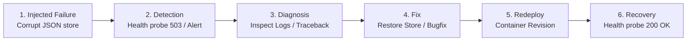

# Monitoring, SRE Practices & Failure Recovery Runbook

This document defines observability standards, health-checking protocols, and incident resolution workflows for the **Online Quiz Application**.

---

## 1. Health Probe Specifications

### Endpoint: `GET /api/health`

The application exposes a health endpoint evaluated by container runtimes, Kubernetes/Docker health checks, and Cloud Run probes.

#### Success Response (`HTTP 200 OK`):
Returned when the server process is responsive and the JSON storage file is accessible and readable:

```json
{
  "status": "healthy",
  "timestamp": "2026-10-14T10:15:30.123456+00:00",
  "storage_healthy": true,
  "version": "1.0.0",
  "environment": "production",
  "message": "Online Quiz Application backend and JSON storage are operating normally."
}
```

#### Degraded / Failure Response (`HTTP 503 Service Unavailable`):
Returned if `backend/data/store.json` is missing, unreadable, or permission-restricted:

```json
{
  "status": "unhealthy",
  "timestamp": "2026-10-14T10:15:30.123456+00:00",
  "storage_healthy": false,
  "version": "1.0.0",
  "environment": "production",
  "message": "JSON storage is inaccessible, corrupted, or has permission issues."
}
```

---

## 2. Structured Application Logging

The logging architecture is configured in `backend/app/logging_config.py`.

### Log Format
```text
[<ISO8601-UTC-TIMESTAMP>] [<LOG-LEVEL>] [<LOGGER-NAME>] <MESSAGE>
```

Example:
```text
[2026-10-14T10:20:00.123456+00:00] [INFO   ] [quiz_app] POST /api/quizzes/quiz-devops-001/submit - Status: 200 - Completed in 12.45ms
```

### Sanitization Policy
To prevent credentials or sensitive tokens from leaking into Cloud Logging:
- Passwords are never logged in plain text or in debug dumps.
- Bearer JWT tokens in the `Authorization` header are excluded from request logs.
- Login failures log the affected email address and reason without echoing the password submitted.

---

## 3. Google Cloud Logging & Monitoring Setup

### Viewing Logs in Cloud Logging
Run the following command to tail backend logs in real time:

```bash
gcloud logging read \
  'resource.type="cloud_run_revision" AND resource.labels.service_name="quiz-backend"' \
  --limit=50 \
  --format="table(timestamp,severity,textPayload)"
```

### Setting up a Metric-Based Alert
1. In the GCP Console, navigate to **Monitoring &rarr; Alerting**.
2. Create an alert policy based on the resource:
   - Resource: `Cloud Run Revision`
   - Metric: `Request Count` with filter `response_code_class = 5xx`
3. Trigger condition: Any occurrence over a 1-minute window.
4. Notification channel: Email or Slack webhook.

---

## 4. End-to-End Failure Demonstration Workflow

For academic demos and DevOps presentations, follow this scenario: **Failure &rarr; Detection &rarr; Diagnosis &rarr; Fix &rarr; Redeployment &rarr; Recovery**.



### Step 1: Simulate a Failure
Simulate a corrupted data store on disk:
```bash
# Intentionally corrupt the store file
echo "{ corrupted_json: true,, " > backend/data/store.json
```

### Step 2: Detection
Run the health probe:
```bash
curl -i http://localhost:8000/api/health
```
**Observed Result:** Returns `HTTP 503 Service Unavailable` with `storage_healthy: false`.

### Step 3: Diagnosis
Inspect the backend container logs:
```bash
docker logs quiz-backend --tail 20
```
**Observed Log Output:**
```text
[CRITICAL] CRITICAL: Storage file at /app/data/store.json is malformed or unreadable: Corrupted JSON store
```
The error pinpointed malformed JSON within the persistence layer.

### Step 4: Fix
Restore the valid JSON store structure or remove the damaged file to allow the auto-seeding engine to recreate standard collections:
```bash
# Remove corrupted file so safe auto-seeding restores store
rm backend/data/store.json
```

### Step 5: Redeployment / Process Restart
Restart the backend service:
```bash
docker compose restart backend
# or python -m uvicorn app.main:app
```

### Step 6: Recovery Verification
Verify that the service self-heals:
```bash
curl -i http://localhost:8000/api/health
```
**Result:** Returns `HTTP 200 OK` with `status: healthy` and `storage_healthy: true`.

---

## 5. SRE Troubleshooting Runbook

| Symptom | Root Cause | Remediation |
| :--- | :--- | :--- |
| **HTTP 401 Unauthorized** on all student actions | Expired JWT token or mismatched `JWT_SECRET_KEY` | Log out and log back in, or check that `JWT_SECRET_KEY` matches between restarts. |
| **HTTP 403 Forbidden** when student accesses route | Student user attempting to call an Admin API | Expected RBAC protection. Switch accounts to `admin@example.com`. |
| **CORS Policy Error** in browser console | Origin header does not match backend `CORS_ORIGINS` | Verify frontend port (5173 / 3000) is included in backend `CORS_ORIGINS`. |
| **HTTP 503 on `/api/health`** | File permissions or corrupted JSON on disk | Check file permissions on `store.json` and validate JSON syntax using `jq . store.json`. |
